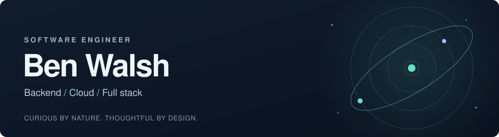

  

  <a href="https://ben.bortle.app"><strong>Portfolio ↗</strong></a>
  &nbsp;&nbsp;·&nbsp;&nbsp;
  <a href="https://www.linkedin.com/in/ben-walsh-7570aa109/"><strong>LinkedIn ↗</strong></a>
  &nbsp;&nbsp;·&nbsp;&nbsp;
  <a href="mailto:bwalsh9764@gmail.com"><strong>Get in touch ↗</strong></a>

 

I'm Ben, a Computer Science graduate from Ontario Tech. I build software around things I care about: planning a night under the stars, running a gaming community, and making everyday work a little easier.

I enjoy the whole path from **a useful interface to a reliable backend**—API design, data modelling, testing, performance, and getting it running in the cloud.

**Ontario, Canada · Open to new-grad and junior software engineering opportunities**

## Selected work

<table>
<tr>
<td width="50%" valign="top">
<h3><a href="https://github.com/days-hub/astroplanner">AstroPlanner</a></h3>

ASTRONOMY · FULL STACK · APPLIED AI

A clearer answer to <em>“what can I see tonight?”</em> Real ephemeris calculations, hourly weather, observing windows, and a personal observation log.

<strong>Engineering focus:</strong> vectorized astronomy calculations and an AI advisor grounded in the app's computed facts, with grounding tests.

<code>Python</code> <code>FastAPI</code> <code>React</code> <code>TypeScript</code> <code>PostgreSQL</code> <code>Docker</code>

<a href="https://bortle.app"><strong>Try the demo ↗</strong></a> &nbsp;·&nbsp; <a href="https://github.com/days-hub/astroplanner">Explore the code</a>

</td>
<td width="50%" valign="top">
<h3><a href="https://github.com/days-hub/arena-master">Arena Master</a></h3>

ESPORTS · BACKEND SYSTEMS · CLOUD

From registration to the final bracket. An esports tournament platform with player profiles, Discord automation, and Riot Games integration.

<strong>Engineering focus:</strong> a Python → Java migration checked across 71 API requests, plus AWS deployments using OIDC and SSM.

<code>Java</code> <code>Spring Boot</code> <code>React</code> <code>PostgreSQL</code> <code>AWS</code> <code>Docker</code>

<a href="https://arena.bortle.app"><strong>Browse the demo ↗</strong></a> &nbsp;·&nbsp; <a href="https://github.com/days-hub/arena-master">Explore the code</a>

</td>
</tr>
<tr>
<td width="50%" valign="top">
<h3><a href="https://github.com/days-hub/YourMusicDepotApp">YourMusicDepot</a></h3>

DESKTOP · SCHEDULING · DATA

A music studio management app for lessons, students, instructors, and payments. Includes a custom weekly scheduler that lays out overlapping appointments.

<code>C#</code> <code>.NET</code> <code>WPF / MVVM</code> <code>EF Core</code> <code>SQL Server</code>

</td>
<td width="50%" valign="top">
<h3><a href="https://github.com/days-hub/FocusFlow">FocusFlow</a></h3>

MOBILE · OFFLINE FIRST · TEAM PROJECT

An adaptive Android productivity app built in a five-person team. My work included SQLite ↔ Firestore sync and K-means analysis of focus patterns.

<code>Dart</code> <code>Flutter</code> <code>Firebase</code> <code>SQLite</code> <code>Kotlin integrations</code>

</td>
</tr>
</table>

## My toolbox

| Area | Technologies |
| :--- | :--- |
| **Languages** | Python · Java · C# · TypeScript · JavaScript · SQL · Dart |
| **Backend & data** | Spring Boot · FastAPI · Flask · .NET · PostgreSQL · SQL Server · SQLite · MongoDB |
| **Web & apps** | React · HTML/CSS · Material UI · Flutter · WPF · Firebase |
| **Cloud & delivery** | AWS · Docker · GitHub Actions · Linux · Bash · Kubernetes (local kind cluster) |
| **Quality & design** | pytest · API contract testing · OAuth 2.0 / JWT · Database migrations · Observability |

<strong>A closer look at the tools behind the projects</strong>

 

- **AWS:** EC2, CloudFront, CloudWatch, IAM/OIDC, Systems Manager, and SNS.
- **Persistence:** Spring Data JPA, SQLAlchemy, Entity Framework Core, Flyway, Alembic, and Firestore.
- **Application tooling:** Spring Security, Pydantic, Vite, nginx, Docker Compose, and Git.
- **Scientific & AI work:** Skyfield/JPL ephemerides, NumPy, Jupyter, K-means clustering, and Claude integration with grounding tests.
- **Business automation:** Power Apps, Power Automate, JavaScript/Office JS, and VBA.
- **Additional foundations:** C++ coursework, sockets/TCP/IP, concurrency, and systems programming.

## Building for real people

At **Ontario Power Generation**, I worked on a three-person team delivering internal business applications, including an Enbridge-partnered replacement for an Excel workflow. I also modernized VBA document generation into reusable **JavaScript / Office JS** tooling, with regular demos and feedback from the people using it.

That experience still shapes how I build: **understand the problem, make the system testable, and keep listening to its users.**

---

  Off the keyboard: competitive gaming, music, and an eight-inch telescope pointed at the sky.

  <a href="https://ben.bortle.app">ben.bortle.app</a>
  &nbsp;·&nbsp;
  <a href="mailto:bwalsh9764@gmail.com">Let's build something useful.</a>

